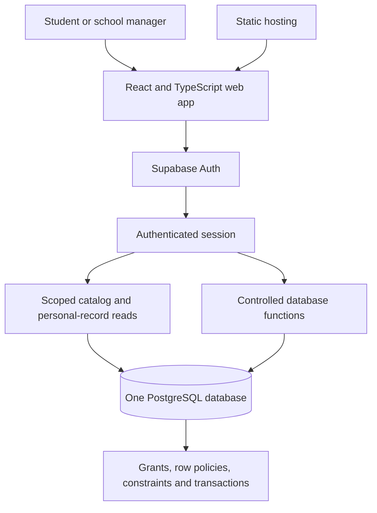

# SupplyLoop: one-day prototype architecture

Design date: October 18, 2026. Status: proposed architecture, not an implemented or deployed app.

## 1. Product contract

SupplyLoop helps a verified school community find, reserve, and collect donated clothing and reusable physical textbooks. A school custodian controls intake and confirms collection. The prototype uses fictional schools, accounts, inventory, and transactions.

The day-one demonstration must complete this flow against a real database:

**Manager receives an item → student finds a suitable item → student reserves it → manager confirms collection → stock and history update.**

Multi-school support means the same application serves separate school communities with enforced data boundaries. It does not mean schools have adopted it, that all schools' policies have been supported, or that open public registration is safe.

## 2. System boundary

The app records information and authorized human confirmations. It does not independently establish that a garment fits, that a book is physically on a shelf, or that a donation would otherwise have gone to landfill. Custodians remain responsible for inspection, accurate stock entry, and physical handoffs.

Day one supports permanent gifts only. Loans, returns, shipping, payments, peer-to-peer messaging, automated access-code verification, and cross-school transfers are excluded.

## 3. Deployment structure

This is one frontend and one managed backend, not separate services for every feature. Supabase's API exposes permitted database operations; it is the application's backend. There is no additional Express server, custom password system, Redis cache, message broker, or AI service in day one.

| Decision | Reason |
|---|---|
| React + TypeScript + Vite | One mobile-friendly browser interface is sufficient for a closed school tool. TypeScript helps keep category fields and operation results consistent. A static frontend avoids a second application-server deployment. |
| Supabase Auth + PostgreSQL | Identity, relationships, authorization, and atomic reservations belong together. Avoid building custom authentication under the deadline. |
| One shared database | New schools become records instead of new deployments. This reduces provisioning and maintenance, but requires tested school isolation. |
| Static hosting, such as Vercel under an appropriate plan | Makes review convenient without app-store approval. Hosting plan terms and credentials are implementation decisions, not assumed to be arranged. |
| Backend-authoritative writes | A browser cannot be trusted to choose its own role, school, borrower, or inventory status. |
| Online writes only | A reservation is successful only after the server confirms it. Offline booking could allocate the same object twice. |

See [Vite's design rationale](https://vite.dev/guide/why) and [Supabase database functions](https://supabase.com/docs/guides/database/functions).

## 4. Identity and roles

Use pre-created email/password test accounts, not public registration or email links. Seed two fictional schools, each with two student accounts and one manager account. Passwords and tokens are managed by Supabase Auth; application tables do not contain passwords.

| Role | Allowed actions |
|---|---|
| Member | Browse the school's usable catalog; reserve; cancel an owned active reservation; see personal reservations; save or close an owned unmet need. |
| Manager | Perform member actions plus intake, inspection/publication, stock corrections, school-local pickup confirmation, release of uncollected reservations, and operational reporting. |
| Developer/operator outside the app | Provision schools and memberships, maintain the demo, export data, and restore fictional seed data. No public platform-admin credentials. |

Managers do not appoint other managers in day one. School selection displays only existing authorized memberships. Choosing a school in the interface never creates membership. A role label is a display of a stored permission, not a permission control.

Use separate authenticated sessions to demonstrate member and manager behavior. A role-switching dropdown must not confer backend privileges.

Reason: fixed accounts remove signup, invitation, domain ownership, SSO, and email-delivery work while still exercising real identity and authorization. Before real deployment, replace this provisioning approach with reviewed school onboarding.

Reference: [Supabase password authentication](https://supabase.com/docs/guides/auth/passwords).

## 5. Minimal data model

Supabase manages `auth.users`. Seven application tables are proposed; `needs` is the first optional feature to omit if the core workflow is behind schedule.

| Table | Main fields | Why it exists |
|---|---|---|
| `schools` | `id`, `name`, `slug`, `enabled_categories`, safe pickup label, term label | Makes school identity and basic configuration data rather than hardcoded Hill behavior. |
| `memberships` | `school_id`, `user_id`, `role`, `active`, school-local display label | The authoritative school/role relationship. Unique `(school_id, user_id)`. |
| `items` | `id`, `school_id`, human-readable item code, category, title, condition, status, category-specific fields, timestamps | One record for one physical object. Contains only catalog-safe information. |
| `item_staff` | `school_id`, `item_id`, exact storage code, inspection fields, operator timestamps | Separates private operational information from the member-readable catalog. |
| `reservations` | `id`, `school_id`, `item_id`, `member_id`, `status`, created/cancelled/completed timestamps, `completed_by` | An allocation and its outcome. Completion fields are the handoff record; no duplicate handoff table in day one. |
| `item_events` | `id`, `school_id`, `item_id`, optional `reservation_id`, action, actor, server timestamp | An append-only application audit trail written by trusted operations. |
| `needs` | `id`, `school_id`, `member_id`, category, structured matching fields, `open/closed`, timestamps | Records demand that browsing alone cannot satisfy. No automatic allocation or notification promise. |

Every school-scoped record carries `school_id`. Composite foreign keys prevent, for example, a School A reservation from referencing a School B item. Member foreign keys also bind a requester to that school's membership. Business functions additionally verify active membership.

### Clothing fields

Garment type, size label and size system, color/variant, optional measurements in a stated unit, and condition. A manager verifies school suitability and readiness before publication. A labeled size is not a guarantee of fit.

### Textbook fields

ISBN-13, edition, format, optional course and term labels, and reuse/approval status. Day one excludes books requiring a one-time digital code and consumable workbooks. A manager's manual approval is required; the app does not infer compatibility from similar titles.

The same ISBN can appear on several item records, but each copy has its own item ID and condition. ISBN/title metadata is deliberately repeated in the tiny prototype to avoid building a full course-catalog system. Normalize editions and course adoptions when real inventory grows.

Use explicit category fields and database checks, not an unrestricted metadata blob. Required book fields cannot be accidentally replaced by garment fields. Optional unmatched fields are null. Do not build a schema for every possible donated object now.

## 6. Data privacy and authority

Enable row-level security and least-privilege grants for every exposed table. Members can read appropriate same-school catalog rows and only their own reservations and needs. Managers can read operational records within their school. Full event history and `item_staff` are manager-only.

RLS restricts rows, not individual fields. That is why exact storage information is in `item_staff`, rather than merely hidden by frontend code. No donor addresses, financial-need labels, student directory, private messages, or real student data are needed for the prototype.

Direct browser writes to the application tables are revoked. Named database functions implement permitted changes after checking the authenticated actor and school. Membership and role cannot come from mutable browser state or a user-editable profile field.

The frontend uses a publishable key and the signed-in user's session. Secret keys and legacy service-role keys never enter the browser or repository. Read-only aggregate views must honor caller security; use manager-scoped queries initially rather than an accidentally privileged dashboard view.

References: [RLS and grants](https://supabase.com/docs/guides/database/postgres/row-level-security), [API-key boundaries](https://supabase.com/docs/guides/getting-started/api-keys).

### Privileged function caution

Because clients cannot directly perform business writes, some operations need narrowly scoped privileged functions. These must explicitly check identity, role, school, ownership, and state. Do not assume RLS still applies inside a privileged function. Use a constrained owner, an empty search path with schema-qualified references, and explicit execute grants; revoke public/unauthenticated execution.

Reference: [Function security](https://supabase.com/docs/guides/database/functions).

## 7. Inventory state and transaction rules

Item states:

`intake → available → reserved → transferred`

`reserved → available` after cancellation or manager release.

`intake/available → retired` for unsuitable or missing stock. A reserved item must first have its reservation released with a reason. A transferred item is terminal in the gift-only prototype.

Reservation states: `active`, `cancelled`, `completed`.

Storing item status as well as reservation status is deliberate: members can see that an object is reserved without reading another student's reservation. Every related change occurs inside one transaction, so the two records cannot drift through separate frontend requests.

### Required business operations

| Operation | Caller | Backend behavior |
|---|---|---|
| `intake_item` | Manager | Create a physical item and staff details; record receipt. |
| `publish_item` | Manager | Verify required fields and inspection; make stock available. |
| `update_item_details` | Manager | Correct permitted catalog/storage fields on intake or available stock, validate category requirements, and record the correction; cannot change school or status. |
| `reserve_item` | Member | Lock the authorized item; verify availability; create one allocation; change status; append event. |
| `cancel_reservation` | Owner or school manager | Lock the item and reservation; cancel active allocation; release stock; append event. |
| `complete_pickup` | School manager, not the requester | Verify the active allocation; record confirmation; transfer stock; append event. Repeated completion must not duplicate the event. |
| `retire_item` | Manager | Retire eligible stock with a controlled reason, retaining history. |
| `save_need / close_need` | Member | Validate and maintain an owned structured request. Optional after core tests pass. |

All functions derive the actor from the authenticated session. School IDs are derived from authorized records or validated against membership. They do not accept a client-selected `completed_by`, elevated role, or new stock status.

### Reservation race

`reserve_item` locks the physical item inside the transaction. A second competing request waits, then rechecks the changed state. A partial unique index permits only one active reservation per item as an additional safeguard. A second completed reservation for a permanently transferred object is also prohibited.

The transaction either changes the allocation, item, and event together or changes none of them. All mutation functions take locks in a consistent order: item first, reservation second. No lock is held while waiting for a human to act.

References: [PostgreSQL row locks](https://www.postgresql.org/docs/current/explicit-locking.html), [partial unique indexes](https://www.postgresql.org/docs/current/indexes-partial.html).

## 8. Matching and demand

Day-one matching is an explainable structured query, not AI:

1. Restrict to the authenticated school and available, approved stock.
2. For clothing, filter by garment type, school-approved variant, size system/label, and minimum condition. Display measurements; do not claim automatic fit.
3. For books, match the exact supplied ISBN/edition and the relevant approval/term. Do not silently substitute editions.
4. Order equally suitable results by oldest available inventory first, then a stable identifier.
5. Explain the result with factual labels such as “exact ISBN” or “matching size label; check measurements.”

Search does not reserve an object. `reserve_item` rechecks availability at the moment of allocation. An empty result can be saved as an unmet need if that feature is completed.

Reason: deterministic rules are inexpensive, understandable, and testable. An LLM adds no needed authority to an exact size/edition lookup. Multi-item bundle optimization, automated matching notifications, and fairness-priority policies are later work; do not describe the first version as having those features.

## 9. Screens and frontend structure

| Screen | Primary purpose | Design reason |
|---|---|---|
| Sign in | Authenticate a seeded account and display its school/role | Real identity without onboarding complexity. |
| Find | Search/filter clothes or books; inspect an item; reserve | Keeps the student's main task short. Item details can be a panel instead of another route. |
| My pickups | Active and completed reservations; cancel an active hold | Gives students a clear next action without exposing other recipients. |
| Manager desk | Inventory and intake tab; pickup queue tab; history tab | Reuses one school workspace instead of building a separate administrative product. |
| Unmet needs | Optional member request form and manager shortage summary | Turns missing inventory into useful donation guidance; omit before weakening security tests. |

Frontend modules: `auth`, `catalog`, `reservations`, `manager`, and optional `needs`, with one backend client and typed operation results. This is a proposed module map, not files already created.

Keep search filters and open-panel state in local React state. Keep inventory and reservations authoritative on the server. Refetch affected data after writes and on returning to a screen; realtime subscriptions are unnecessary initially. Show a pending indicator until the server confirms a reservation. Never show a completed pickup after a failed request.

Clear account-specific cached data on sign-out. Any cache key includes user and school. Provide explicit empty, loading, permission-denied, already-reserved, and network-failure states. Use labeled native controls, keyboard navigation, and a single-column mobile layout.

## 10. Operational reporting

The manager screen calculates counts from current records and completed reservations. Do not maintain a second editable statistics table.

Show available units, active reservations, completed demo transfers, and open needs by size or ISBN when implemented. A persistent “Fictional demo data” notice applies to the entire demo, including its metrics.

Do not put money or carbon claims in day one. Future financial reporting requires dated valuation sources, an immutable completion-time value snapshot, and a separate measure for recipient-reported avoided spending. Actual disposal avoidance needs its own baseline.

Reason: basic verifiable operational counts are more defensible than a polished but unsupported impact dashboard.

## 11. Demo and maintenance

Seed two fictional schools, six fixed-role accounts, and a small set of clothing and book copies. Include identical ISBNs in both schools, plus a wrong-edition book and an unavailable item, to test exclusions.

Use a demo-only backend with no actual student records. Provision accounts through trusted operator tooling. Reviewer credentials are limited test credentials, never cloud-console or platform-admin credentials. Shared test accounts may need operator restoration and are not a production account design.

Keep schema, grants, functions, and seed definitions versioned together. Seed data contains no passwords or keys. Any reset is an explicit operator action restricted to the fictional dataset, not a public button that can delete arbitrary school records.

Before submission, save a reproducible version and test reviewer access in a fresh browser session. Public deployment is useful only if it is stable. Do not silently switch to browser-only mock persistence when the backend is unavailable; disclose the limitation and keep a reliable run path.

## 12. Acceptance criteria

The prototype is complete only when these pass against the real backend:

1. A manager receives and publishes a valid garment and a physical book copy.
2. A student can find and reserve each category; data survives refresh and another authenticated session can see the permitted change.
3. Wrong ISBN/edition and wrong garment size do not satisfy the structured search.
4. School A cannot read or mutate School B's catalog, staff details, reservations, needs, membership records, or event history through direct API calls.
5. A student cannot become a manager, change an item's school, read another student's reservation, or confirm their own pickup.
6. Two different students race to reserve one object: exactly one allocation succeeds.
7. Cancellation releases stock. Authorized pickup completes it. Repeated completion cannot inflate transaction counts.
8. Invalid transitions and direct table mutations fail. Successful operations append the expected audit event.
9. Signing out clears private screen/cache state; a fresh login sees only authorized records.
10. Reviewers can operate the main flow on desktop and mobile without waiting for an email or school approval.

Use backend allow/deny tests as well as browser testing. A hidden button is not a successful authorization test. See [Supabase database testing](https://supabase.com/docs/guides/database/testing).

## 13. Build order and scope cuts

1. **Database and identity:** tables, constraints, fixed accounts, grants, policies, and minimal authorized reads.
2. **Core operations:** intake, publication, reservation, cancellation, collection, and events. Test invalid actors and concurrent reservations immediately.
3. **Interface:** sign-in, catalog, personal pickups, manager desk, and failure states.
4. **Second-school proof:** complete the direct-API isolation checks and demonstrate separate school inventory.
5. **Only if the above passes:** saved unmet needs and shortage summary.
6. **Final work block:** fresh-session/mobile testing, reproducible snapshot, demo recording, and submission explanation.

Do not trade away permission checks or the reservation transaction to add more screens. If a single day is insufficient, reduce optional features and state the incomplete parts honestly.

| Deferred feature | Why it can wait |
|---|---|
| QR/camera | A typed item code and authenticated collection button prove the workflow without camera/token complexity. |
| Photo upload | Avoids file handling and moderation; category icons and accurate text suffice for the prototype. |
| Automated email, reminders, expiration | Avoids SMTP and scheduled-job dependencies. Cancellation and manager release work manually today; no automatic-expiry claim. |
| Public school onboarding and SSO | Requires institutional verification and permission review. Operator-provisioned schools still demonstrate a shared architecture. |
| Live ISBN lookup and course catalog | Manual metadata and explicit approval are sufficient to test edition-aware behavior. |
| Loans and returns | Introduce due dates, loss policies, and repeated circulation, which differ from permanent donations. |
| Cross-school exchange | Introduces transfer custody, transport, recipient-school approval, and lineage rules. |
| AI and bundle optimization | Not needed for correct structured matching; can follow measured workflow demand. |

## 14. Expansion path and governance

After a real school agrees to pilot, review student-data handling and retention, membership provisioning, allocation policy, pickup arrangements, inspection rules, staff succession, accessibility, and operational funding. Add uploaded images, automated expiry, and notifications only as the workflow needs them.

Normalize textbook editions/course adoptions, add configurable storage locations, and make school setup self-service only after verifying the organization and its administrator. Future partner sharing must be opt-in; do not merge all school inventory or reveal recipient histories.

Document exports and restoration, separate uploaded-file backups when uploads exist, and maintain more than one authorized operator. Maintain student code/IP arrangements consistent with CAC rules. AI assistance must be disclosed, and the entrant must make significant technical contributions and understand the implementation. [2026 CAC rulebook](https://www.congressionalappchallenge.us/wp-content/uploads/2026/05/2026-CAC-Rules.pdf)

The intended day-end claim is: **“A working prototype with school-isolated inventory, exact item filtering, protected reservations, and manager-confirmed handoffs, demonstrated with fictional clothing and textbook records.”**
